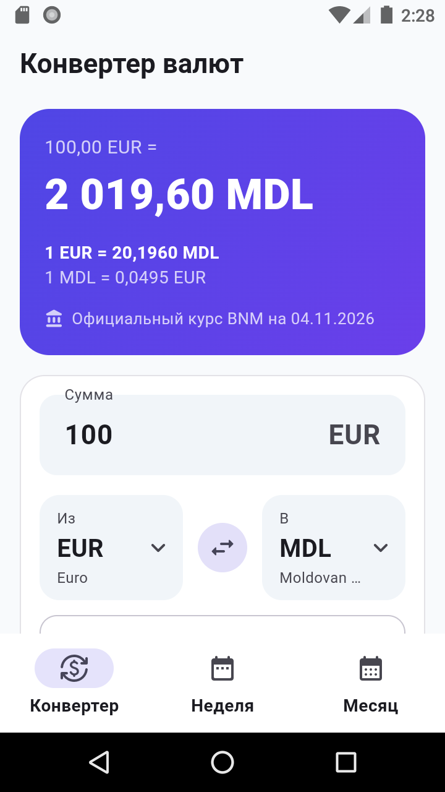
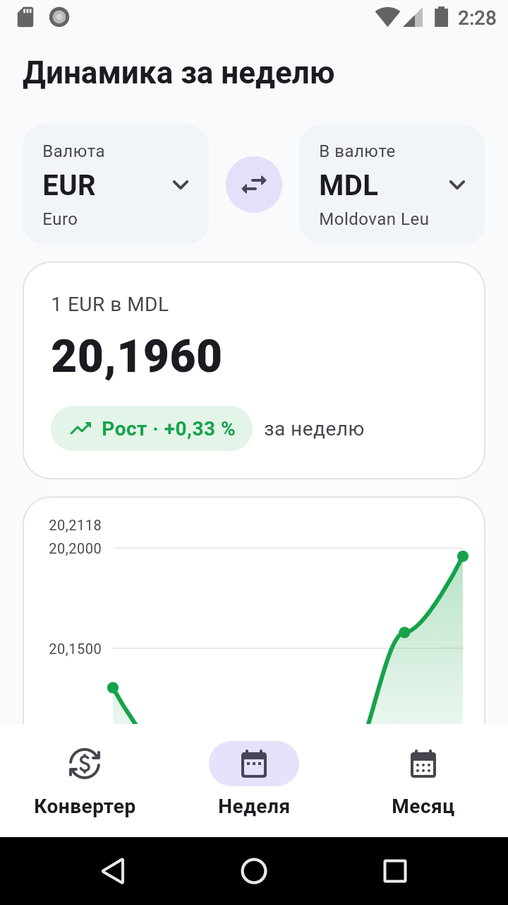
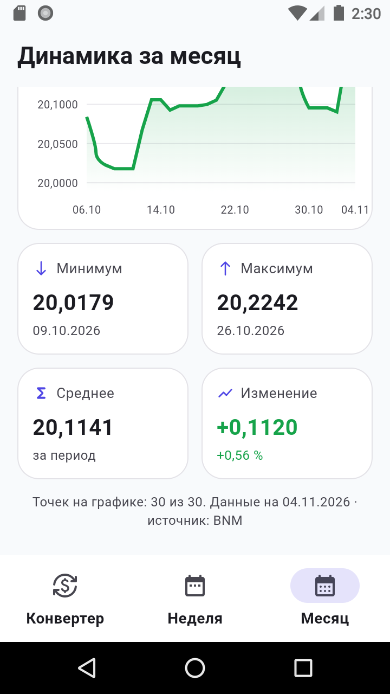
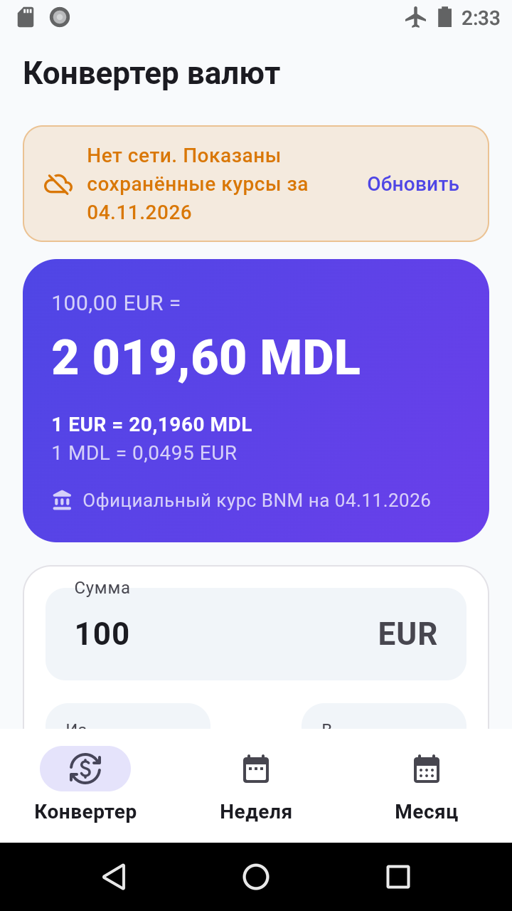

# BNM Currency — mobile converter with analytics

An Android app built with Flutter. It converts currencies using the official exchange rates of the National Bank of Moldova (BNM) and shows how a currency pair changed over the last week and month.

| Converter | Week | Month statistics | Offline |
|---|---|---|---|
|  |  |  |  |

## Features

- **Converter.** Enter an amount and choose two of about 40 currencies plus MDL (searchable list). Swap them with one tap and pick any past date. The result shows the rate in both directions, the rate date and the source.
- **Week and Month screens.** For the selected pair:
  - a line chart of the rate over the period;
  - minimum and maximum, each with its date;
  - the average over the period;
  - the change in absolute units and in percent;
  - a trend label: rise, fall or no change (below 0.01 %).
- **History source.** One request to BNM per day of the period; responses are cached on the device. Past days are never downloaded twice.
- **Offline mode.** Without a network the app does not crash: it shows the last saved rates and history together with the date they were current. The cache survives app restarts.
- **Date fallback.** If BNM has not published rates for the chosen date yet (for example, a future date), the app steps back up to 10 days and says which date it uses.
- **Input validation.** Empty, zero, negative, non-numeric or over-precise amounts show a clear message under the field.
- Material 3 design with an indigo accent; light and dark themes follow the system setting.

## Requirements

- Flutter 3.47+ (Dart 3.13+)
- Android SDK; an emulator or a physical device with Android 8.0+

## Run

```bash
flutter pub get
flutter run
```

## Tests

```bash
flutter test
```

The 45 unit tests cover:
- parsing of the BNM XML, including `Value / Nominal` rates, malformed and empty responses;
- HTTP behavior: the exact URL, 404, 500, no network and timeout (via `MockClient`, no real requests);
- the repository: caching, date fallback, offline fallback and history building;
- statistics: min, max, average, absolute and percent change, trend, empty data set;
- amount validation and conversion in both directions.

## Architecture

```
lib/
├── main.dart                  # Composition root: wires API, cache, repository and controllers
├── domain/                    # Pure Dart, no Flutter
│   ├── models.dart            # Currency, RateSnapshot (cross rates via MDL), RatePoint
│   ├── statistics.dart        # PeriodStats: min/max/avg/change/trend
│   ├── converter.dart         # Conversion with forward and reverse rates
│   ├── amount_validator.dart  # User input rules and messages
│   └── errors.dart            # SourceUnavailableException, NoRatesForDateException
├── data/
│   ├── bnm_parser.dart        # XML → RateSnapshot
│   ├── bnm_api.dart           # RateSource interface + HTTP implementation
│   ├── rate_store.dart        # RateStore interface + file cache (atomic writes)
│   └── rate_repository.dart   # Cache/network policy, date fallback, offline mode, history
└── ui/
    ├── app.dart               # MaterialApp, theme, bottom navigation
    ├── rates_controller.dart  # Converter state (pair, date, rates)
    ├── history_controller.dart# Period history state
    ├── screens/               # Converter, Week/Month analytics
    └── widgets/               # Currency picker, chart, status banners
```

The UI depends only on controllers, controllers only on `RateRepository`, and the repository only on the `RateSource` and `RateStore` interfaces. Tests replace both with fakes.

## Data source

`https://www.bnm.md/en/official_exchange_rates?get_xml=1&date=DD.MM.YYYY` is official and free, with no API key. BNM returns rates for weekends too (the previous working day's rate under the weekend date) and HTTP 404 for dates that are not published yet.

## Notes

`path_provider_android` is pinned below 2.3: version 2.3 depends on the `jni` package, which requires a full Android NDK to build.
